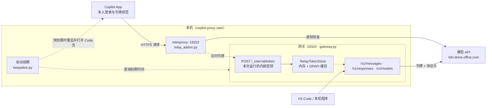

# Copilot App 本机代理

把 Microsoft Copilot 桌面应用（下称 Copilot App）能用的模型，以本地 API 的形式提供给 VS Code、Codex CLI 等程序：Claude 系列走 Messages 协议，GPT 系列走 Responses 协议。代理只转发请求和流式响应；工具调用、确认和对话管理仍由调用方负责。

> 仅限组织允许的本人账号使用。本项目不是微软官方集成，不提供账号、订阅或令牌；能否使用取决于你的账号、组织和 Copilot 版本。调查过程与已验证范围见 [API-DISCOVERY.md](API-DISCOVERY.md)。

## 工作原理

```text
Copilot App ──HTTPS──▶ 本机 mitmproxy ──▶ 模型 API
                            │ 截取访问令牌
                            ▼
VS Code ──────────▶ 本机网关（附上令牌）──▶ 模型 API
```

1. `start` 让 Copilot App 经本机代理联网，App 请求模型 API 时，代理截取其中的访问令牌交给网关。
2. VS Code 等程序向网关发请求，网关附上令牌转发给模型 API，并原样返回（含 SSE 流）。
3. 令牌约 1–1.5 小时过期。快到期时，自动续期进程重启 Copilot App 并打开 Code 页，让 App 自己取得新令牌。

代理不读取 App 的登录缓存，也不自行刷新令牌；登录和续签始终由 Copilot App 完成。

## 快速开始

### 1. 环境要求

- Windows 10/11（依赖 DPAPI 和 UI 自动化），PowerShell 5.1 或更高；不需要管理员权限。
- Python 3.12 或更高。
- 已登录、能正常使用 Code 页的 Copilot App（GitHub Copilot 插件或网页版不能替代）。

### 2. 安装

```powershell
git clone https://github.com/madderscientist/copilot-app-proxy.git
Set-Location copilot-app-proxy
.\install.ps1
```

脚本在项目内创建 `.venv/` 并安装依赖，不改动证书、代理设置或 Copilot。

- 找不到 Python：`.\install.ps1 -PythonExecutable 'D:\Python\python.exe'`（不能用 Windows 应用商店的占位入口）。
- 使用组织镜像：`.\install.ps1 -PythonIndexUrl <pip simple 地址>`，地址中不要写入密码或令牌。
- 禁止运行脚本时：`py -3 -m copilot_app_proxy.cli install`（镜像参数为 `--index-url`）。

之后的命令都通过 `.\.venv\Scripts\copilot-proxy.exe` 执行，下文简写为 `copilot-proxy`。

### 3. 启动

先结束 Copilot App 中正在进行的任务，然后运行 `copilot-proxy start`。它会：

1. 启动网关（`127.0.0.1:19324`）和 HTTPS 代理（`127.0.0.1:19323`）。
2. 把本次生成的临时 CA 加入**当前用户**的受信任根证书，Windows 可能弹出确认。
3. 重启 Copilot App，只让这个 App 进程走代理，系统代理不变。
4. 自动打开 Code 页，App 随即请求模型列表，网关拿到令牌（不消耗额度）。
5. 启动自动续期，然后留在终端显示日志，底部固定一行状态栏：

```text
15:42:10 [gateway] POST /v1/messages model=claude-opus-5.5 stream=true -> 200 headers=1.20s total=8.40s
15:44:43 [keepalive] Token has 240s left; relaunching Copilot App (attempt 1).
15:45:03 [gateway] Token updated: exp=2026-11-18T07:45:58Z

 Token 61 min left (expires 16:45, renews ~16:41)  keep-alive on | Ctrl+C to stop
```

- 每行日志依次是时间、来源（`gateway`、`mitm`、`keepalive`）和内容。网关为每个 API 请求记一行，不含令牌、提示词或回复。客户端中途停止（如在 VS Code 里点停止）时状态记为 `aborted`，网关会立即断开对应的上游请求。
- 颜色：状态码 2xx 绿、4xx 黄、5xx 红；令牌更新为绿，重试等提示为黄，错误为红。状态栏的令牌块底色为绿（正常）、黄（即将续期）或红（没有可用令牌或网关无响应）。设置 `NO_COLOR` 可关闭颜色。
- 按 **Ctrl+C** 停止：结束所有进程、移除临时 CA（Windows 会弹出确认），并关闭 Copilot App。

### 4. 接入 VS Code

在 VS Code 聊天的模型管理中选择 **Add Models → Custom Endpoint**，填入 `copilot-proxy vscode-config` 输出的 JSON，详见[客户端配置](#客户端配置)。

使用 Remote SSH 时，需要在 ~/.ssh/config 中为远程主机配置 `RemoteForward 19324 127.0.0.1:19324`，以便将本地网关端口转发到远程主机：
```
Host my-remote
    HostName <远程主机地址>
    RemoteForward 19324 127.0.0.1:19324
```

## 日常使用

### 命令

| 命令 | 作用 |
| --- | --- |
| `start` | 启动代理并留在终端显示日志，Ctrl+C 停止 |
| `stop` | 停止代理、移除临时 CA、关闭 Copilot App；也用于清理异常退出的残留 |
| `status` | 查看网关、代理、自动续期、临时 CA 和令牌的状态 |
| `refresh` | 立即重启 Copilot App 并打开 Code 页，尝试取得新令牌 |
| `vscode-config` | 生成 VS Code 的 Custom Endpoint 配置 |
| `doctor` | 检查 Python、mitmdump、Copilot App 路径和端口占用 |
| `keepalive` | 在当前终端运行自动续期，仅在以 `--no-keepalive` 启动后需要 |

`start` 的选项：

| 选项 | 作用 |
| --- | --- |
| `--detach` | 启动后立即返回，代理在后台运行，用 `stop` 停止 |
| `--no-keepalive` | 不启动自动续期 |
| `--observe` | 调查用：把 Copilot App 的请求元数据写入 `.local/logs/observe.jsonl` |
| `--gateway-port` / `--proxy-port` | 临时改用其他端口 |
| `--copilot-path` / `--mitmproxy-path` | 指定 `copilotapp.exe` 或 `mitmdump.exe` 的位置 |

网关、代理和自动续期都是独立的后台进程，前台的 `start` 只负责显示日志和退出时清理，所以 `--detach` 的功能与默认方式相同。

### 令牌续期

自动续期默认开启：令牌剩余不足 240 秒时，重启 Copilot App 并打开 Code 页。

- App 只在令牌剩余约 5 分钟以内才换新，更早重启只会拿回旧令牌；只靠闲置也不会续期。
- 期间你正常使用 App 带出了新令牌，续期会自动顺延。
- 没拿到新令牌时每 60 秒重试，连续 5 次失败后停止，网关返回 `401`。此时可运行 `refresh`，或在 Code 页发一条消息。
- 续期会重启 Copilot App，App 里正在进行的任务会中断；VS Code 的对话不受影响。锁屏、休眠或 App 需要重新登录时无法续期。
- 续期进程连续约 30 秒连不上网关就自行退出，不会在代理停止后继续重启 App。

令牌有效期还长时运行 `refresh`，会显示 `reused cached token` 并返回 1，这是正常现象。

### 停止与异常退出

`stop`（前台按 Ctrl+C 相同）会关闭 Copilot App：它的代理设置在启动时固定，代理停止后无法继续使用。之后需要时自己打开即可，会直接联网。

移除临时 CA 时 Windows 会弹出确认；若取消，`stop` 会报错并保留记录，可再次执行。加密的令牌缓存 `.local/token.dpapi` 会保留，供下次启动使用。

| 情况 | 结果与处理 |
| --- | --- |
| 直接关闭终端窗口 | 依次结束自动续期、Copilot App 和代理，但来不及移除临时 CA；`status` 会提示运行 `stop` |
| 注销或关机 | 进程都会结束，临时 CA 仍在，运行 `stop` 清理 |
| 后台进程被强行结束 | Copilot App 会断网，运行 `stop`，或完全退出 App 后重新打开 |

临时 CA 留在受信任列表里不影响使用，但其私钥（`.local/mitm-ca/`）一旦泄露，就可能被用来伪造网站证书，应及时用 `stop` 清理。

### 日志

日志写入 `.local/logs/`：`gateway.log`、`mitm.log`、`keepalive.log`，以及记录异常输出的 `.err.log`。每次 `start` 会清空；`gateway.log` 超过 5 MB 时转存为 `gateway.log.1`，总量不超过约 10 MB。日志文件不含颜色代码，终端被重定向时也只输出纯文本。

`--observe` 写入的 `observe.jsonl` 每行记录 Copilot App 的一个请求：方法、路径、状态码、令牌 SHA-256 的前 12 位，以及 JWT 的 `iat`/`nbf`/`exp`，不含令牌本身或请求内容。

### 端口与更新

长期改用其他端口时，编辑 [config.json](./config.json) 的 `gateway_port` 和 `proxy_port`。优先级：命令行参数 > 正在运行的代理所记录的端口（仅查询类命令）> `config.json` > 默认值。

更新前先 `stop`，再 `git pull --ff-only` 并重新运行 `.\install.ps1`。卸载时先运行 `stop`，确认临时 CA 已移除，再删除项目目录。

## 常见问题

| 现象 | 处理方式 |
| --- | --- |
| 找不到 Python / mitmdump.exe | 安装 Python 3.12+，或用 `-PythonExecutable` 指定；再运行 `.\install.ps1` |
| 找不到 Copilot App | 先打开 Copilot App 再启动，或用 `--copilot-path` |
| 端口被占用 | 停止旧代理，或换用未占用的端口（两个端口不能相同） |
| 未自动打开 Code 页 | 手动点开 Code 页 |
| 网关返回 `401` | 运行 `refresh`，或在 Code 页发一条消息 |
| Copilot App 无法联网 | 运行 `stop`，或完全退出 App 后重新打开 |
| 出现证书错误 | 不要跳过证书校验；运行 `stop` 后重新 `start` |
| 模型不可用、版本头或服务地址变化 | 账号或 App 版本可能不适用，参考 API-DISCOVERY |
| Chat 页的 Fable、Grok 等模型不在列表中 | 它们走 M365 Copilot 的会话接口，不在 Code 页的模型 API 中，无法接入，见 [API-DISCOVERY 第八节](API-DISCOVERY.md#八chat-页的模型未接入) |

## 客户端配置

### VS Code

Custom Endpoint 不会自己查询模型列表，需要逐个列出模型。`vscode-config` 通过网关读取模型列表，Claude 系列配为 `/v1/messages`（`apiType: messages`），GPT 系列配为 `/v1/responses`（`apiType: responses`），名称、上下文窗口和思考强度都取自上游；网关未运行或令牌过期时输出内置列表。示例（每个系列一个模型）：

```json
[
  {
    "name": "本机 Copilot App 代理",
    "vendor": "customendpoint",
    "apiKey": "local",
    "models": [
      {
        "id": "claude-opus-5.5",
        "name": "Claude Opus 5.5 (本机代理)",
        "url": "http://127.0.0.1:19324/v1/messages",
        "apiType": "messages",
        "toolCalling": true,
        "vision": true,
        "thinking": true,
        "adaptiveThinking": true,
        "contextWindow": 1000000,
        "maxOutputTokens": 128000,
        "supportsReasoningEffort": ["low", "medium", "high", "xhigh", "max"]
      },
      {
        "id": "gpt-5.6-sol",
        "name": "GPT-5.6 Sol (本机代理)",
        "url": "http://127.0.0.1:19324/v1/responses",
        "apiType": "responses",
        "toolCalling": true,
        "vision": true,
        "contextWindow": 1050000,
        "maxOutputTokens": 128000,
        "supportsReasoningEffort": ["none", "low", "medium", "high", "xhigh", "max"]
      }
    ]
  }
]
```

`apiKey` 填任意非空值即可，网关不校验也不转发。地址请用 `127.0.0.1`，网关不监听 IPv6。

**思考强度与上限**

- 在模型选择器的 **Effort Level** 中切换强度，传入不支持的档位会返回 400。
- **Claude**：以 `"output_config": {"effort": "high"}` 发送。上游只接受 `"thinking": {"type": "adaptive"}`，其他取值返回 400；不传时同样会自适应思考。
- **GPT**：以 `"reasoning": {"effort": "high"}` 发送，多数模型还支持 `none`（`gpt-61-sol` 不支持）。
- 上下文窗口 Claude 为 1000000，GPT 为 1050000。Claude 的 `max_tokens` 超过 128000 会被拒绝；GPT 的 `max_output_tokens` 上游不校验，128000 并非已验证的上限。
- 两个系列都支持图片输入（`"vision": true`）。模型列表不声明这一点，是实测得出的。

### Codex CLI

Codex 只支持 Responses 协议，只能使用 GPT 模型。在 `~/.codex/config.toml` 中配置（未在本机实测）：

```toml
model = "gpt-5.6-sol"
model_provider = "copilot-app-proxy"

[model_providers.copilot-app-proxy]
name = "Copilot App 本机代理"
base_url = "http://127.0.0.1:19324/v1"
wire_api = "responses"
env_key = "COPILOT_APP_PROXY_KEY"
```

`COPILOT_APP_PROXY_KEY` 填任意非空值。Codex 不查询 `/v1/models`，模型信息来自其内置列表。

### 本地接口

| 接口 | 用途 |
| --- | --- |
| `GET /healthz` | 网关状态与令牌到期时间（不返回令牌） |
| `GET /v1/models` | 原样返回上游模型列表 |
| `POST /v1/messages` | Claude 系列，支持 SSE |
| `POST /v1/responses` | GPT 系列，支持 SSE |

- `/v1/models` 是 Copilot 自己的格式（`data[].id`、`supported_endpoints`、`capabilities` 等），只读取 `data[].id` 的客户端可以直接使用。
- 上游没有 Chat Completions 和 `count_tokens`。GPT 只能走 Responses，`store` 须为 `false`；流式响应中多一个自定义事件 `llmapi.call_cost`，标准客户端会忽略。
- `/healthz` 的 `upstreamAuthenticated: true` 只表示缓存令牌按 `exp` 尚未过期，能否调用以实际响应为准。
- 网关会补齐客户端、会话和 API 版本请求头，API 版本默认 `2026-10-21`，上游更新后可能需要调整。

## 安全说明

- **只对本机开放**：网关和代理只监听 `127.0.0.1`，不要改成 `0.0.0.0`。模型接口不需要密钥，但会拒绝带浏览器 `Origin` 头、非本机 `Host` 或查询参数的请求，网页无法借用。
- **不适用于多用户电脑**：同一台电脑上其他 Windows 用户的程序也能访问 `127.0.0.1`，从而使用你的模型额度。
- **令牌的去向**：只截取发往模型 API 的请求里的访问令牌，不收集 Cookie 或刷新令牌。令牌只存在于网关内存和 `.local/token.dpapi`（当前 Windows 用户的 DPAPI 加密），不通过本地接口返回，也不写入日志。
- **调用方凭据不外传**：调用方附带的 `Authorization`、`x-api-key`、Cookie 等不会转发给上游。
- **无法注入伪造令牌**：网关接收令牌的内部接口使用每次启动随机生成的密钥，只有本次运行的代理插件持有。
- **不要分享 `.local/`**：其中有临时 CA 私钥、令牌缓存和日志，已被 `.gitignore` 排除。

## 开发

```powershell
.\.venv\Scripts\python.exe -m pip install -e ".[dev]"
.\.venv\Scripts\python.exe -m pytest -v
.\.venv\Scripts\python.exe -m ruff check copilot_app_proxy tests
```

测试只使用模拟请求和临时缓存，不需要真实账号、令牌或额度。



| 模块 | 职责 |
| --- | --- |
| `gateway.py` | 本机请求校验、路由、请求头组装、JSON/SSE 转发、错误映射与请求日志 |
| `relay_store.py` / `dpapi.py` | 令牌缓存、到期判断与 DPAPI 持久化 |
| `relay_addon.py` | mitmproxy 插件：截取令牌推送给网关；可选的观察日志 |
| `cli/launcher.py` | `start` / `stop`：进程编排、证书信任、Copilot App 启动与清理 |
| `cli/foreground.py` / `cli/ansi.py` | 前台视图：日志着色、状态栏、窗口标题、关闭窗口时的快速停止 |
| `cli/keepalive.py` | `refresh` / `keepalive` |
| `cli/windows.py` | Windows 进程查询、证书操作、启停锁与 Code 页的 UI 自动化 |
| `cli/diagnostics.py` | `status` / `doctor` / `vscode-config` |
| `cli/server.py` | 网关进程入口，写入并轮转 `gateway.log` |
| `cli/__main__.py` / `cli/config.py` / `cli/bootstrap.py` | 命令行分发；路径、端口与运行记录；`install` |

核心库（`copilot_app_proxy/` 下除 `cli/` 外的模块）不依赖 `cli`。其他程序可以用 `create_app(relay_store=..., relay_ingest_secret=...)` 和 `listen(app, port)` 嵌入网关；单独加载 mitmproxy 插件时需设置 `RELAY_INGEST_URL` 和 `RELAY_INGEST_SECRET`。
