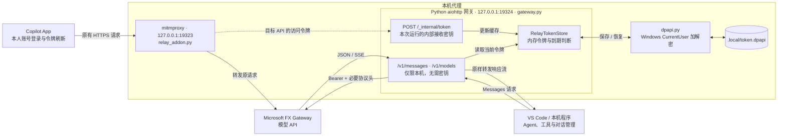

# Copilot App 本机代理

将本机 Copilot App 的模型访问中继到本地 Messages API，供 VS Code 等客户端使用。代理转发请求和 SSE 流，不运行 Copilot CLI 的 agent 或工具执行流程，工具定义、执行和确认仍由 VS Code 负责。

仅限组织允许的本人账号会话复用。安装成功不等于获得模型权限；不同账号、组织、地区和 Copilot 版本的服务及模型可用性可能不同。本项目不是微软官方集成，也不提供账号、订阅或令牌。

API 调查过程和已验证的适用范围见 [API-DISCOVERY.md](API-DISCOVERY.md)。

## 当前状态

- 网关默认监听 `http://127.0.0.1:19324`，本机程序调用无需密钥。
- Copilot App 的 HTTPS 代理默认监听 `http://127.0.0.1:19323`。
- 已实测通过本地网关获取模型列表，并调用 `claude-opus-5.5` 返回 `200`。
- 自动化测试覆盖 Messages 转发、SSE、凭据隔离、错误处理和 DPAPI 缓存。VS Code 完整 agent 工作流仍需按实际配置验证。

## 环境要求

- Windows 10/11，使用本人账号的 PowerShell 5.1 或更高版本。
- Python 3.12 或更高版本。
- 已安装、已登录并可正常使用 Code 功能的 Microsoft Copilot 桌面应用。GitHub Copilot 插件或网页版不能替代此桌面应用。
- 能够访问 PyPI 和账号实际使用的模型服务；企业网络可指定获准的包源。

项目使用 Windows DPAPI，当前不支持 macOS 或 Linux。运行不需要管理员权限，但会在当前用户证书库中添加临时 CA，需要本人同意。

## 首次安装

克隆仓库，或下载并解压仓库源码，然后在项目目录中运行安装脚本：

```powershell
git clone https://github.com/madderscientist/copilot-app-proxy.git
Set-Location copilot-app-proxy
.\install.ps1
```

脚本自动查找 Python 3.12+，创建项目内的 `.venv/`，从 `pyproject.toml` 安装依赖，并以可编辑模式安装本项目。它不修改全局 Python 配置，不安装证书、不启动代理或重启 Copilot。

- 自动检测不到 Python 时，指定真实解释器（不能用 Windows 商店的空占位入口）：`.\install.ps1 -PythonExecutable 'D:\Python\python.exe'`。
- 组织要求使用专用镜像时，传入 `-PythonIndexUrl <pip simple index 地址>`；未指定时沿用本机 pip 配置，地址不会被持久化。不要在命令行或配置文件中写入带密码、令牌的包源地址。
- 若 PowerShell 禁止运行脚本，可直接用 Python 执行同一安装：`py -3 -m copilot_app_proxy.cli install`（镜像参数为 `--index-url`）。

安装完成后，所有操作都通过 `.\.venv\Scripts\copilot-proxy.exe` 完成，运行 `copilot-proxy --help` 可查看全部命令。

## 启动与停止

```powershell
.\.venv\Scripts\copilot-proxy.exe start
```

`start` 会启动网关和 HTTPS 代理，在当前用户根证书库中信任本次代理 CA，随后重启 Copilot App 并为其进程配置代理，不修改系统代理。请先结束 Copilot 中正在执行的任务；如果 Windows 提示证书信任确认，需要本人确认。

启动后，在 Copilot App 的 Code 页发送一次消息，让中继获取当前模型 API 的访问令牌。

停止代理、移除临时根证书及其私钥目录，并恢复 Copilot App 的普通启动方式：

```powershell
.\.venv\Scripts\copilot-proxy.exe stop
```

停止后会保留 DPAPI 加密的上游令牌缓存 `.local/token.dpapi`，以便下次启动使用；不再需要时可在停止后删除。旧版本生成的 `.local/gateway-key.dpapi` 已不再使用，可直接删除。

同一项目的启停不能并行执行。若提示另一条启停命令正在运行，请等它结束再重试。若停止时 Copilot 未能恢复普通启动，先解决报错，再执行 `stop`；用于恢复的记录会保留到操作成功。

### 端口与路径

长期使用其他端口时，编辑项目根目录的 [config.json](./config.json)（`gateway_port` 和 `proxy_port`）。端口按以下顺序确定：

1. 命令行参数 `--gateway-port` / `--proxy-port`；
2. `status` 和 `vscode-config` 会优先使用正在运行的会话所记录的端口，运行中编辑配置不会造成不一致；
3. `config.json`；
4. 默认值 `19324` / `19323`。

```powershell
.\.venv\Scripts\copilot-proxy.exe start --gateway-port 19424 --proxy-port 19423
```

启动时优先从正在运行的 Copilot App 获取程序路径，否则使用标准安装位置。如果安装在其他目录，或希望使用自己安装的 mitmproxy，可显式指定：

```powershell
.\.venv\Scripts\copilot-proxy.exe start --copilot-path 'D:\Apps\Copilot\copilotapp.exe' --mitmproxy-path 'D:\Tools\mitmdump.exe'
```

### 状态检查与诊断

```powershell
.\.venv\Scripts\copilot-proxy.exe status   # 网关、代理、临时 CA 和上游令牌是否就绪
.\.venv\Scripts\copilot-proxy.exe doctor   # 端口冲突、路径未找到或启动异常时自检
```

## 更新与卸载

更新前先停止代理，避免替换正在使用的依赖：

```powershell
.\.venv\Scripts\copilot-proxy.exe stop
git pull --ff-only
.\install.ps1
.\.venv\Scripts\copilot-proxy.exe start
```

卸载时先运行 `copilot-proxy stop`，确认临时证书已移除、Copilot 已恢复普通启动，再删除整个项目目录。不要在代理仍运行时直接删除 `.local/` 或项目目录。

## 常见问题

| 现象 | 处理方式 |
| --- | --- |
| 未找到 Python | 安装 Python 3.12+ 并重新打开终端，或使用 `.\install.ps1 -PythonExecutable <完整路径>` |
| 未找到 mitmdump.exe | 先运行 `.\install.ps1`，默认位置为 `.venv/Scripts/mitmdump.exe` |
| Copilot 不在标准目录 | 先打开 Copilot 再启动代理，或使用 `--copilot-path` |
| 首次启动等待证书确认 | 在本人 Windows 会话中确认临时证书提示；不要使用管理员提升或关闭证书校验替代 |
| 端口占用 | 先停止旧代理，或指定未占用且互不相同的网关和代理端口 |
| 网关返回没有令牌或令牌已过期 | 在 Copilot 的 Code 页发一次消息，等应用取得新令牌；网关不会替应用登录 |
| 代理连接后出现证书错误 | 不要跳过 HTTPS 证书验证；停止代理，确认当前用户证书与安装流程，必要时重新启动 |
| 模型未开放、版本头或服务地址变化 | 该账号或应用版本可能不适用；参考调查记录，不能把本机缓存当作额外授权 |

## 接入 VS Code

在聊天的模型管理中选择 **Add Models → Custom Endpoint**，API 类型选择 **Messages**。以下命令按当前端口生成配置：

```powershell
.\.venv\Scripts\copilot-proxy.exe vscode-config
```

默认端口下的输出如下：

```json
[
  {
    "name": "本机 Copilot App 代理",
    "vendor": "customendpoint",
    "apiKey": "local",
    "models": [
      {
        "id": "claude-opus-5.5",
        "name": "claude-opus-5.5",
        "url": "http://127.0.0.1:19324/v1/messages",
        "apiType": "messages",
        "toolCalling": true,
        "vision": false,
        "contextWindow": 1000000,
        "maxOutputTokens": 32768
      }
    ]
  }
]
```

网关不校验 API Key，`"local"` 只是满足 VS Code 必填要求的占位值。其他本机程序同样可以直接调用，不需要任何密钥。

## 令牌与安全边界

- 中继插件只提取发往 `loki.delve.office.com/api/v1/llmapi/` 的 Bearer 访问令牌，不收集 Cookie 或刷新令牌。
- 令牌更新依赖 Copilot App 自己的登录和刷新流程。过期后，在 Code 页触发请求，应用取得新令牌后，中继才会更新缓存；代理不会自行冒用应用刷新令牌。
- 上游令牌使用 Windows DPAPI 的 `CurrentUser` 范围加密保存在 `.local/token.dpapi`，不能当作可跨用户、跨机器迁移的凭据。
- 临时 CA 私钥位于 `.local/mitm-ca/`，不可分享；`stop` 会清理该目录及证书信任项。
- 网关与代理只绑定 `127.0.0.1`。模型接口不需要密钥，但拒绝带浏览器 `Origin` 头、非本机 `Host` 或 URL 查询参数的请求，网页无法借用本机网关。
- 调用方附带的 `Authorization`、`x-api-key`、Cookie 等不会转发给上游；上游只收到中继缓存的令牌和必要协议头。
- 内部令牌接收接口使用每次启动随机生成的密钥，只有本次运行的 mitmproxy 插件持有，其他程序无法注入伪造令牌。
- **使用前提**：网关对本机所有进程开放。同一 Windows 用户下的程序本来就能用 DPAPI 解密令牌缓存，因此免密钥不扩大这部分暴露面；但同一台电脑上**其他 Windows 用户**的程序也能通过 `127.0.0.1` 使用你的模型额度。请勿在多人共用的电脑或服务器上运行。
- 不记录原始访问令牌、Cookie 或对话正文。`.local/`、`.venv/` 和环境变量文件已被排除在版本控制之外，不应上传本机运行状态。

## 接口与状态检查

```powershell
Invoke-RestMethod http://127.0.0.1:19324/healthz
```

`status: ok` 表示网关已启动。`upstreamAuthenticated: true` 仅表示存在尚未按到期时间判定过期的缓存令牌，不代表刚完成了一次上游鉴权；实际可用性以模型接口响应为准。

| 本地接口 | 用途 |
| --- | --- |
| `GET /healthz` | 健康检查与令牌到期状态，不返回令牌 |
| `GET /v1/models` | 获取上游模型列表 |
| `POST /v1/messages` | Messages 请求，支持 SSE 流式响应 |
| `POST /v1/messages/count_tokens` | 转发计数请求，上游支持情况尚未验证 |

生产上游固定为 `https://loki.delve.office.com/api/v1/llmapi/`。代理补齐必需的客户端、会话和 API 版本请求头，API 版本默认使用已验证的 `2026-10-21`；上游更新后可能需要调整。

## 开发测试

```powershell
.\.venv\Scripts\python.exe -m pip install -e ".[dev]"
.\.venv\Scripts\python.exe -m pytest -v
.\.venv\Scripts\python.exe -m ruff check copilot_app_proxy tests
```

测试只使用模拟请求和临时测试缓存，不需要真实账号、令牌或模型额度。

## 目录结构

```text
copilot-app-proxy/
  README.md                 本文档
  API-DISCOVERY.md          API 调查记录与适用范围
  config.json               网关和代理的默认端口
  pyproject.toml            项目配置、依赖与 copilot-proxy 入口
  install.ps1               查找 Python 3.12+ 并执行 install
  copilot_app_proxy/        核心库，不依赖 cli 子包
    gateway.py              aiohttp 网关：本机请求校验、路由、请求头组装与 JSON/SSE 转发
    relay_store.py          内存与 DPAPI 令牌缓存、到期判断与令牌错误类型
    relay_addon.py          mitmproxy 插件：提取访问令牌并推送给网关
    dpapi.py                Windows DPAPI 加解密（crypt32.dll）
    cli/                    copilot-proxy 命令行
      __main__.py           参数解析与命令分发
      config.py             项目路径、端口解析与运行记录
      bootstrap.py          install：创建 .venv 并安装依赖
      launcher.py           start / stop：进程编排、证书信任与 Copilot 重启
      windows.py            Windows 进程查询、证书操作、进程存活检测与启停锁
      diagnostics.py        status / doctor / vscode-config
      server.py             start 在后台拉起的网关进程（内部命令 serve）
  tests/                    自动化测试套件
  .local/                   本机加密状态、日志与临时证书，禁止提交
  .venv/                    项目 Python 环境，禁止提交
```

源码中不包含本机运行状态。请勿分享 `.local/`、`.venv/`、环境变量文件、证书私钥、DPAPI 缓存或日志；`.gitignore` 已排除这些内容。

## 整体架构

代理包含两条独立链路：Copilot App 负责登录及更新令牌；VS Code 负责组织模型请求、执行工具和管理自己的 agent 流程。两者不共享 harness 或对话状态。



### 请求与令牌流程

1. **启动**：`copilot-proxy start` 生成仅本次运行使用的内部接收密钥，在后台启动网关和 mitmproxy。网关加载 DPAPI 令牌缓存（如有）。临时 CA 只加入当前用户证书库，代理配置只传给新启动的 Copilot App 进程。
2. **令牌更新**：Copilot App 正常请求模型 API 时，插件只提取目标域名及路径下的 Bearer 令牌，推送给 `/_internal/token`。网关更新内存及 DPAPI 缓存后返回成功，插件才标记该令牌已送达。
3. **失败重试**：内部推送最多等待 3 秒。失败时不标记已送达，下次匹配的 Copilot 请求会重试同一令牌；没有额外轮询或后台刷新任务。
4. **独立推理**：VS Code 等本机程序直接提交请求，网关取出当前令牌，补齐 API 版本、会话及客户端头，再向固定上游发起独立请求。请求体及工具定义不做协议转换。
5. **流式返回**：网关用 `aiohttp` 流式转发上游响应，保留 SSE 数据和背压；客户端断开时关闭对应上游请求。mitmproxy 的响应也采用流式转发。
6. **过期与停止**：网关读取 JWT 的 `exp` 进行本地到期判断，真正的验签和授权由上游负责。令牌缺失或过期时返回 `401`，提示在 Copilot App 中触发更新。`stop` 关闭代理、删除临时 CA 并恢复 Copilot App，保留 DPAPI 缓存。

### 模块职责

| 模块 | 职责 |
| --- | --- |
| `gateway.py` | 本机请求校验、接口路由、请求头组装、JSON/SSE 转发与错误映射 |
| `relay_store.py` | 令牌缓存、到期判断、DPAPI 持久化，以及令牌缺失/过期/持久化失败等错误 |
| `relay_addon.py` | 定向提取访问令牌、向内部接口推送、成功后去重；不解析 JWT、不管理刷新 |
| `dpapi.py` | 用当前 Windows 用户身份（`crypt32.dll`）加解密本机缓存 |
| `cli/launcher.py` / `cli/windows.py` | 管理进程、临时证书和 Copilot 代理配置 |
| `cli/diagnostics.py` | 状态检查、环境诊断与 VS Code 配置生成 |
| `cli/config.py` | 项目路径、端口解析和运行记录 |
| `cli/server.py` | 由 `start` 在后台调用，组装令牌缓存并运行网关 |

核心库不依赖 `cli` 子包。其他 Python 程序可直接使用 `create_app(relay_store=..., relay_ingest_secret=...)` 和 `listen(app, port)` 嵌入网关；单独加载 mitmproxy 插件时，必须显式提供 `RELAY_INGEST_URL` 和 `RELAY_INGEST_SECRET`，否则插件不会推送令牌。桌面启停和 DPAPI 持久化仅支持 Windows。

### 凭据边界

- **模型接口**不需要密钥，仅接受本机 Host、不带浏览器 Origin 的请求；调用方附带的凭据不会转发给模型服务。
- **内部接收密钥**仅由本次运行的插件和网关共享，用于令牌更新接口，不交给 VS Code，也不落盘。
- **上游访问令牌**只在插件、网关内存、DPAPI 缓存及固定目标 API 之间流转，不由本地接口返回。
- `/healthz` 只提供运行及缓存到期状态；缓存可用不等于上游必然接受该令牌。
