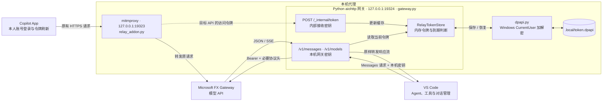

# Copilot App 本机代理

将本机 Copilot App 的模型访问中继到本地 Messages API，供 VS Code 等客户端使用。代理转发请求和 SSE 流，不运行 Copilot CLI 的 agent 或工具执行流程，工具定义、执行和确认仍由 VS Code 负责。

仅限组织允许的本人账号会话复用。安装成功不等于获得模型权限；不同账号、组织、地区和 Copilot 版本的服务及模型可用性可能不同。本项目不是微软官方集成，也不提供账号、订阅或令牌。

API 调查过程和已验证的适用范围见 [API-DISCOVERY.md](API-DISCOVERY.md)。

## 当前状态

- 网关默认监听 `http://127.0.0.1:19324`。
- Copilot App 的 HTTPS 代理默认监听 `http://127.0.0.1:19323`。
- 已实测通过本地网关获取模型列表，并调用 `claude-opus-5.5` 返回 `200`。
- 自动化测试覆盖 Messages 转发、SSE、认证隔离、错误处理和 DPAPI 缓存。VS Code 完整 agent 工作流仍需按实际配置验证。

## 环境要求

- Windows 10/11，使用本人账号的 PowerShell 5.1 或更高版本。
- [Python](https://www.python.org/downloads/windows/) 3.12 或更高版本，可通过 `py` 或 `python` 启动。
- 已安装、已登录并可正常使用 Code 功能的 Microsoft Copilot 桌面应用。GitHub Copilot 插件或网页版不能替代此桌面应用。
- 能够访问 PyPI 和账号实际使用的模型服务；企业网络可指定获准的包源。

项目使用 Windows DPAPI，当前不支持 macOS 或 Linux。运行不需要管理员权限，但会在当前用户证书库中添加临时 CA，需要本人同意。

## 首次安装

克隆仓库，或下载并解压仓库源码，然后在项目目录中运行安装：

```powershell
git clone https://github.com/madderscientist/copilot-app-proxy.git
Set-Location copilot-app-proxy
.\install.ps1
```

安装脚本创建项目内的 `.venv/`，从 `pyproject.toml` 安装固定版本 mitmproxy 和 aiohttp，并可编辑安装 `copilot-app-proxy`。它不修改全局 Python 配置，不安装证书、不启动代理或重启 Copilot。

如果自动检测不到 Python，可指定真实解释器，不能使用 Windows 商店的空占位入口：

```powershell
.\install.ps1 -PythonExecutable 'D:\Python\python.exe'
```

默认直接运行 `.\install.ps1`，不需要填写包源。只有组织要求使用专用镜像时，才需要传入 `-PythonIndexUrl`（真实的 pip simple index 地址）。地址应由组织提供，未指定时沿用本机 pip 配置，脚本不会持久化这些地址。文档中的 `.example` 域名仅可用于说明，不能作为实际下载地址。

不要在命令行或配置文件中写入带密码、令牌的包源地址，请使用组织批准的凭据管理方式。

## 启动与停止

日常启动：

```powershell
.\start-transparent-proxy.ps1 -CopyKey
```

启动脚本会启动网关和 HTTPS 代理，在当前用户根证书库中信任本次代理 CA，随后重启 Copilot App 并为其进程配置代理，不修改系统代理。请先结束 Copilot 中正在执行的任务；如果 Windows 提示证书信任确认，需要本人确认。

`-CopyKey` 会把本机网关密钥复制到剪贴板，不打印密钥。启动后，在 Copilot App 的 Code 页发送一次消息，让中继获取当前模型 API 的访问令牌。

可指定其他端口：

```powershell
.\start-transparent-proxy.ps1 -GatewayPort 19324 -ProxyPort 19323 -CopyKey
```

启动脚本优先从正在运行的 Copilot App 获取程序路径，否则使用标准安装位置。如果安装在其他目录，或希望使用自己安装的 mitmproxy，可显式指定：

```powershell
.\start-transparent-proxy.ps1 -CopilotPath 'D:\Apps\Copilot\copilotapp.exe' -MitmproxyPath 'D:\Tools\mitmdump.exe' -CopyKey
```

停止代理、移除临时根证书及其私钥目录，并恢复 Copilot App 的普通启动方式：

```powershell
.\stop-transparent-proxy.ps1
```

停止后会保留 DPAPI 加密的网关密钥和上游令牌缓存，以便下次启动使用。若不再需要上游令牌缓存，可在停止后删除 `.local/token.dpapi`。

### 状态检查与一键诊断

随时查看代理、临时 CA 和上游令牌是否就绪：

```powershell
.\status.ps1
```

遇到端口冲突、路径未找到或启动异常时运行自检：

```powershell
.\doctor.ps1
```

也可直接调用 Python CLI：

```powershell
.\.venv\Scripts\python.exe -m copilot_app_proxy vscode-config
.\.venv\Scripts\python.exe -m copilot_app_proxy key
```

## 更新与卸载

更新前先停止代理，避免替换正在使用的依赖：

```powershell
.\stop-transparent-proxy.ps1
git pull --ff-only
.\install.ps1
.\start-transparent-proxy.ps1 -CopyKey
```

卸载时先运行停止脚本，确认临时证书已移除、Copilot 已恢复普通启动，再删除整个项目目录。不要在代理仍运行时直接删除 `.local/` 或项目目录。

## 常见问题

| 现象 | 处理方式 |
| --- | --- |
| 未找到 Python | 安装 Python 3.12+ 并重新打开终端，或通过 `-PythonExecutable` 指定 Python |
| 未找到 mitmdump.exe | 先运行 `install.ps1`，默认位置为 `.venv/Scripts/mitmdump.exe` |
| Copilot 不在标准目录 | 先打开 Copilot 再启动代理，或使用 `-CopilotPath` |
| 首次启动等待证书确认 | 在本人 Windows 会话中确认临时证书提示；不要使用管理员提升或关闭证书校验替代 |
| 端口占用 | 先停止旧代理，或指定未占用且互不相同的网关和代理端口 |
| 网关返回没有令牌或令牌已过期 | 在 Copilot 的 Code 页发一次消息，等应用取得新令牌；网关不会替应用登录 |
| 代理连接后出现证书错误 | 不要跳过 HTTPS 证书验证；停止代理，确认当前用户证书与安装流程，必要时重新启动 |
| 模型未开放、版本头或服务地址变化 | 该账号或应用版本可能不适用；参考调查记录，不能把本机缓存当作额外授权 |

## 接入 VS Code

在聊天的模型管理中选择 **Add Models → Custom Endpoint**，API 类型选择 **Messages**，使用以下配置：

```json
[
  {
    "name": "本机 Copilot App 代理",
    "vendor": "customendpoint",
    "apiKey": "${input:gatewayCredential}",
    "models": [
      {
        "id": "claude-opus-5.5",
        "name": "Claude Opus 5.5 本机代理",
        "url": "http://127.0.0.1:19324/v1/messages",
        "apiType": "messages",
        "toolCalling": true,
        "vision": false,
        "contextWindow": 1000000,
        "maxOutputTokens": 32768
      }
    ]
  }
]
```

在 VS Code 的安全 API Key 输入框中粘贴 `-CopyKey` 复制的**本机网关密钥**，不是 Copilot 的云端访问令牌。不要把密钥填进配置文件、聊天或仓库。

## 令牌与安全边界

- 中继插件只提取发往 `loki.delve.office.com/api/v1/llmapi/` 的 Bearer 访问令牌，不收集 Cookie 或刷新令牌。
- 令牌更新依赖 Copilot App 自己的登录和刷新流程。过期后，在 Code 页触发请求，应用取得新令牌后，中继才会更新缓存；代理不会自行冒用应用刷新令牌。
- 网关密钥和上游令牌使用 Windows DPAPI 的 `CurrentUser` 范围加密保存，不能当作可跨用户、跨机器迁移的凭据。
- 临时 CA 私钥位于 `.local/mitm-ca/`，不可分享；停止脚本会清理该目录及证书信任项。
- 网关与代理只绑定 `127.0.0.1`。模型请求需要本机网关密钥，内部令牌接收接口使用另一份独立密钥。
- 不记录原始访问令牌、Cookie 或对话正文，不接受 URL 查询参数、浏览器 Origin 请求或非本机 Host。
- `.local/`、`node_modules/` 和环境变量文件已被排除在版本控制之外，不应上传本机运行状态。

## 接口与状态检查

```powershell
Invoke-RestMethod http://127.0.0.1:19324/healthz
```

`status: ok` 表示网关已启动。中继模式下，`upstreamAuthenticated: true` 仅表示存在尚未按到期时间判定过期的缓存令牌，不代表刚完成了一次上游鉴权；实际可用性以模型接口响应为准。

| 本地接口 | 用途 |
| --- | --- |
| `GET /healthz` | 无需密钥的健康检查，不返回令牌 |
| `GET /v1/models` | 获取上游模型列表 |
| `POST /v1/messages` | Messages 请求，支持 SSE 流式响应 |
| `POST /v1/messages/count_tokens` | 转发计数请求，上游支持情况尚未验证 |

生产上游固定为 `https://loki.delve.office.com/api/v1/llmapi/`。代理补齐必需的客户端、会话和 API 版本请求头，API 版本默认使用已验证的 `2026-10-21`；上游更新后可能需要调整。

## 其他运行模式

### 调用方提供令牌

```powershell
.\.venv\Scripts\python.exe -m copilot_app_proxy
```

每次请求使用 `Authorization: Bearer <上游访问令牌>` 或 `x-api-key: <上游访问令牌>`，二者只能选一个。此模式不会获取或刷新令牌；Azure 管理 API 令牌、GitHub 令牌或任意本机密钥不能替代目标资源令牌。

## 开发测试

先安装开发依赖（包含异步测试插件），然后运行：

```powershell
.\.venv\Scripts\python.exe -m pip install -e ".[dev]"
.\.venv\Scripts\python.exe -m pytest -v
.\.venv\Scripts\python.exe -m ruff check copilot_app_proxy tests
```

测试只使用模拟请求和临时测试缓存，不需要真实账号、令牌或模型额度。

## 目录结构

```text
copilot-app-proxy/
  README.md                       中文使用说明
  pyproject.toml                  Python 项目配置、依赖与 CLI 入口
  install.ps1                     项目内依赖安装入口
  start-transparent-proxy.ps1     启动中继并配置 Copilot
  stop-transparent-proxy.ps1      停止中继并恢复 Copilot
  status.ps1                      一键查看代理与令牌状态
  doctor.ps1                      一键诊断环境与端口问题
  copilot_app_proxy/
    __main__.py                   CLI 入口（serve / status / doctor / key / vscode-config）
    gateway.py                    aiohttp 网关、SSE 流式转发与路由
    relay_store.py                内存与 DPAPI 令牌缓存及到期判断
    relay_addon.py                Copilot 请求令牌中继插件
    dpapi.py                      Windows DPAPI 原生加解密（crypt32.dll）
    cli_tools.py                  状态检查、环境诊断、密钥与 VS Code 配置生成
  tests/                          自动化测试套件
  .local/                         本机加密状态、日志与临时证书，禁止提交
  .venv/                          项目 Python 环境，禁止提交
```

源码中不包含本机运行状态。请勿分享 `.local/`、`.venv/`、环境变量文件、证书私钥、DPAPI 缓存或日志；`.gitignore` 已排除这些内容。

## 整体架构

代理包含两条独立链路：Copilot App 负责登录及更新令牌；VS Code 负责组织模型请求、执行工具和管理自己的 agent 流程。两者不共享 harness 或对话状态。



### 请求与令牌流程

1. **启动**：启动脚本加载或生成 DPAPI 加密的本机网关密钥，生成仅本次运行使用的内部接收密钥，启动 Python 网关和 mitmproxy。临时 CA 只加入当前用户证书库，代理配置只传给新启动的 Copilot App 进程。
2. **令牌更新**：Copilot App 正常请求模型 API 时，插件只提取目标域名及路径下的 Bearer 令牌，推送给 `/_internal/token`。网关更新内存及 DPAPI 缓存后返回成功，插件才标记该令牌已送达。
3. **失败重试**：内部推送最多等待 3 秒。失败时不标记已送达，下次匹配的 Copilot 请求会重试同一令牌；没有额外轮询或后台刷新任务。
4. **独立推理**：VS Code 使用本机网关密钥提交请求，网关取出当前令牌，补齐 API 版本、会话及客户端头，再向固定上游发起独立请求。请求体及工具定义不做协议转换。
5. **流式返回**：网关用 Python `aiohttp` 流式转发上游响应，保留 SSE 数据和背压；客户端断开时关闭对应上游请求。mitmproxy 的响应也采用流式转发。
6. **过期与停止**：网关读取 JWT 的 `exp` 进行本地到期判断，真正的验签和授权由上游负责。令牌缺失或过期时返回 `401`，提示在 Copilot App 中触发更新。停止脚本关闭代理、删除临时 CA 并恢复 Copilot App，保留 DPAPI 缓存。

### 模块职责

| 模块 | 职责 |
| --- | --- |
| `start-transparent-proxy.ps1` / `stop-transparent-proxy.ps1` | 进程、端口、临时证书和 Copilot 代理配置的生命周期 |
| `status.ps1` / `doctor.ps1` | 一键状态查看与环境/端口/证书自检 |
| `relay_addon.py` | 定向提取访问令牌、向内部接口推送、成功后去重；不解析 JWT、不管理刷新 |
| `gateway.py` / `relay_store.py` | 本机认证、接口路由、令牌缓存、请求头组装和 JSON/SSE 转发 |
| `dpapi.py` | 用当前 Windows 用户身份（`crypt32.dll`）加解密本机缓存 |
| `cli_tools.py` | 状态检查、环境诊断、密钥与 VS Code 配置生成 |

两种模式最终都复用同一请求转发逻辑，仅令牌来源不同：`--relay` 从中继缓存读取，默认模式使用调用方提供的上游令牌。

### 密钥边界

- **本机网关密钥**用于 VS Code 到网关的认证，保存在 `.local/gateway-key.dpapi`；不会转发给模型服务。
- **内部接收密钥**仅由本次运行的插件和网关共享，用于令牌更新接口，不交给 VS Code。
- **上游访问令牌**只在插件、网关内存、DPAPI 缓存及固定目标 API 之间流转，不由本地接口返回。
- `/healthz` 只提供运行及缓存到期状态；缓存可用不等于上游必然接受该令牌。