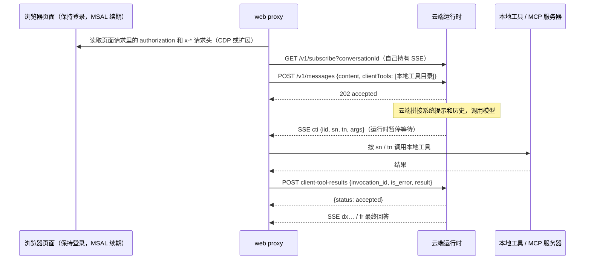
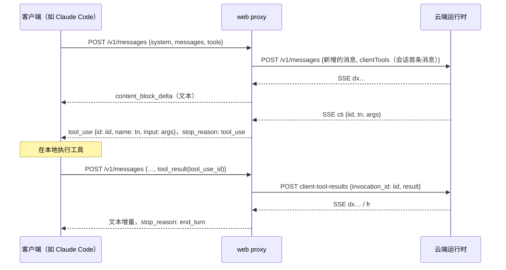
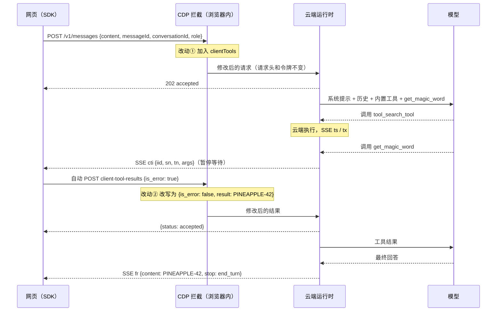
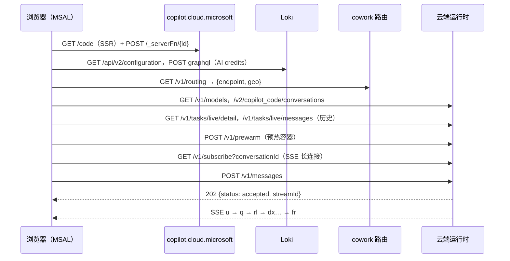

# Web Proxy 方案记录（网页版 Copilot Code）

本文按“如果要做 web proxy，应该怎么做”的思路，整理对网页版 Code（`copilot.cloud.microsoft/code`）的调查。**本项目不打算实现，本文仅作记录。** 未注明的结论均为实测；来自静态代码（阅读页面加载的公开 JS）或模型自述的会单独注明。

调查时间为 2026 年 11 月，前端版本 `2.20261118.22.0`。结果只描述当时的版本、本机账号和组织允许的实验范围，不代表公开 API 承诺。App 侧的调查见 [API-DISCOVERY.md](API-DISCOVERY.md)。本文不保存访问令牌、Cookie、账号或租户身份信息。

## 一、先明确能做成什么

web proxy 只能做成**云端 agent 会话的桥接**，做不成本项目现有的模型 API 代理：

| 问题 | 结论 | 依据 |
| --- | --- | --- |
| 能否从网页拿到 `llmapi` 令牌、沿用现有网关 | 不能。网页从不请求 `llmapi`；网页的 `configuration` 令牌调用 `llmapi/models` 返回 403 `access_blocked` | 实测 |
| 历史由谁保存 | 运行时。请求只带当前这一句 | 实测 |
| 能否定义系统提示 | 不能替换，只能追加 | 实测、静态代码 |
| 能否由调用方定义工具 | 能，通过客户端工具 `clientTools` | 实测 |
| 能否禁用运行时自带的工具 | 没有找到接口；这些工具在云端容器中执行 | 静态代码、模型自述 |
| 计费 | 每轮消耗 AI credits（会话快照带 `costCredits`，模型列表带 `usage_multiplier`） | 实测 |

## 二、整体架构

以最简单的形态为例：proxy 直接执行本地工具（本地 MCP 桥），用户在网页或命令行里对话。



proxy 要做五件事：取得认证（第三节）、定位运行时（第四节）、维护会话并发送消息（第五节）、把订阅流转换成客户端的流式响应（第六节）、桥接工具调用（第七节）。

## 三、认证：借用页面的请求头

- 运行时令牌由页面内的 MSAL.js 获取。页面本地存有 MSAL 缓存条目，发往 Graph、Loki、路由服务和运行时的请求各自带 `authorization`。
- 做法：保持一个已登录的页面，用 CDP 或浏览器扩展读取页面自己发出的运行时请求中的 `authorization` 和 `x-*` 请求头。不读取 MSAL 缓存或刷新令牌，与现有 `relay_addon` 只取访问令牌的边界一致。
- 续期交给页面，不需要重启 App，也能跨平台。能维持多久见第九节。

## 四、定位运行时

| 步骤 | 请求 |
| --- | --- |
| 路由 | `GET cowork.<区域>.gateway.prod.island.powerapps.com/v1/routing`，返回 `{endpoint, geo}` |
| 运行时地址 | `mcsaetherruntime-<区域>.<...>.gateway.prod.island.powerapps.com`（Power Platform 网关） |
| 模型列表 | `GET /v1/models`：`gpt-5.5`、`gpt-6.1-sol-substrate`、`opus-5.5`、`opus-5.5-fast`、`sonnet-5.5`；`orchestrator_type` 均为 `copilot` |

运行时请求带 `authorization`、`x-tenant-id`、`x-user-id`、`x-experience-id`、`x-container-type`、`x-container-config`、`x-conversation-id`。

## 五、会话与发送

| 步骤 | 请求 |
| --- | --- |
| 列出会话 | `GET /v2/copilot_code/conversations` |
| 读取历史 | `GET /v1/tasks/live/detail`、`/v1/tasks/live/messages` |
| 预热容器 | `POST /v1/prewarm` |
| 订阅事件 | `GET /v1/subscribe?conversationId=`，`text/event-stream` 长连接 |
| 发送 | `POST /v1/messages`，返回 `202 {status: accepted, streamId}`；回复从订阅流推送 |

请求体只有当前这一句：

```json
{"content": [{"type": "text", "text": "..."}], "messageId": "<uuid>", "conversationId": "<会话>", "role": "user"}
```

- 在首页发送第一条消息会创建新会话；向已有的 `conversationId` 发送则延续该会话。会话 ID 形如 `<租户>:<用户>:code-<uuid>`。
- 请求里没有 `system`、历史消息和模型参数。只发送 “hi” 时，回复也会带上用户姓名和产品能力介绍，说明系统提示和身份上下文由运行时注入。
- SDK 还支持在请求体中附带 `attachment`（上传文件后的 `workspaceUrl`）、`model`（模型 ID 或 `auto`）、`agentId`、`context`、`connectorsConfig`（静态代码，未实测）。

proxy 要做的映射：

- **会话**：客户端每次发送完整历史，而运行时自己保存历史。proxy 需要把客户端会话映射到 `conversationId`，只发送新增的那条消息。会话键怎么取见第九节。
- **系统提示**：客户端的 `system` 无法生效，只能并入首条消息正文，或写进账号级自定义指令 `agent.customInstructions`（`{enabled, text}`，`text` 最长 65536 字符，通过 `/v1/settings` 写入；静态代码，未实测）。

## 六、接收回复

proxy 自己持有 `/v1/subscribe`，把事件转换成客户端的流式响应。事件名是缩写，含义按字段推断：

| 事件 | 字段 | 含义 | 转换方式 |
| --- | --- | --- | --- |
| `session` | `model`、`modelSelection` | 会话状态 | 忽略或记录 |
| `u` / `q` | `id` / `mid` | 用户消息回显、入队 | 确认发送成功 |
| `rl` | `st`（`started`、`ok`、`fail`）、`turns`、`tc` | agent 循环的开始、结束与统计 | `fail` 转为错误 |
| `dx` | `t` | 文本增量 | 文本 `content_block_delta` |
| `th` | `c` | 思考内容增量 | 丢弃或转为思考块（没有签名，客户端是否接受未验证） |
| `ts` / `tx` | `tid`、`tn`、`ok` | 工具开始、结束 | 云端工具只能记录日志 |
| `tk` | `items[].phase` | 任务进度，例如新会话的 `workspace_provision`、`container_connect`、`cli_init` | 忽略 |
| `cti` | `iid`、`rid`、`sn`、`tn`、`args` | 客户端工具调用 | 转为 `tool_use`，见第七节 |
| `fr` | `stop`、`content` | 最终回复与停止原因 | `message_delta` 和 `message_stop` |

实现时注意：

- **补发的旧事件**：建立订阅时，会先补发该会话最近的事件。重新加载页面后，立即收到了上一轮的 `uv`（`session_stop`）和 `rl`（`ok`）。需要按 `u`/`q` 中的消息 ID 区分本轮事件。SDK 内部也按事件 ID 去重，并区分 `catchup`、`live`、`history`（静态代码）。
- **`fr.content` 不一定有**：一次较长的回复中，`fr` 没有带 `content`。回复正文应以累积的 `dx` 为准。
- **其他事件**：还有 `ti`（会话标题）、`rh`（回复建议）、`cq`、`ic`、`up`、`co`、`ck`、`rpc` 等，含义未确认，可以忽略。

## 七、工具调用

### 协议

1. 发送 `/v1/messages` 时附带工具目录（SDK 限制目录不超过 1 MB）：

   ```json
   "clientTools": [{"serverName": "proxy_tools", "displayName": "Proxy tools",
     "tools": [{"toolName": "get_magic_word", "description": "...", "parametersSchemaJson": "{\"type\":\"object\",...}"}]}]
   ```

2. 模型调用工具时，订阅流推送 `cti`，内容为 `{iid, rid, sn, tn, args}`。运行时暂停，等待结果。
3. 客户端用 `POST /v1/conversations/code-<uuid>/client-tool-results` 回传 `{invocation_id, is_error, result, error_message}`。路径里只用会话 ID 的 `code-<uuid>` 部分。服务端返回 `{status: accepted}`，运行时继续同一轮。
   - 已验证可用的 `result` 格式为 `{"content": [{"type": "text", "text": "..."}]}`。
   - SDK 对回传失败的分类（静态代码）：404 / 409 表示该调用已不在等待（`not-pending`），400 / 413 表示结果过大，503 表示会话不可用。

运行时的处理方式：

- 每个 `serverName` 被当作一个 MCP 服务器，模型看到的工具名是 `mcp__<serverName>__<toolName>`；`cti` 里的 `tn` 仍是原名。
- 这些工具是延迟加载的。模型第一次使用前要先调用运行时自带的 `tool_search_tool`，之后可以直接调用。
- 工具目录在会话内保留，只需在会话的第一条消息里附带。
- 回传 `is_error: true` 时，错误会作为工具结果交给模型，例如 `MCP server 'proxy_tools': Error: mcp__proxy_tools__get_magic_word failed: ...`。模型继续回答，本轮正常结束，不会中断会话。

### proxy 的映射

第二节的本地 MCP 桥不需要这层转换。作为 Claude Code 等客户端的后端时，工具调用要在两套协议之间转换：



- **注册**：把客户端请求中的 `tools` 转成工具目录：`name` → `toolName`，`description` → `description`，`input_schema` → `parametersSchemaJson`（JSON 字符串）。若要接本地 MCP 服务器，`tools/list` 的 `name`、`description`、`inputSchema` 也能直接对应。
- **调用与结果**：返回 `tool_use` 后，运行时这一轮保持等待。客户端下一次请求的末尾是 `tool_result`，按 `tool_use_id` 找回 `iid` 并回传，然后继续读同一订阅流。
- **避开网页抢答**：网页宿主不支持客户端工具（能力默认值为 `clientTools: "unsupported"`），收到 `cti` 时会立即自动回传 `is_error: true` 和 “The host did not execute this client tool.”。如果网页也打开着同一个会话，proxy 必须拦下这条请求，或让网页不停留在该会话。

### 验证实验

用 CDP 拦截页面自己发出的请求，没有自行构造请求，也没有取出令牌。实验 1 改动的位置：



1. **注入并伪造成功**：在页面的 `POST /v1/messages` 请求体里加入只含 `get_magic_word` 的工具目录，再把页面的拒绝改写为 `{"content":[{"type":"text","text":"PINEAPPLE-42"}]}`。
   - 请求返回 `202`，自定义的 `serverName` 没有被拒绝。
   - 模型先调用工具搜索，再调用 `get_magic_word`（`tc: 2`）。
   - 最终回复为 `PINEAPPLE-42`，`fr.stop` 为 `end_turn`。
   - 这个工具没有在任何地方真正执行过，结果是拦截脚本写入的固定字符串。
2. **客户端不执行**：注入目录，但不改写页面的拒绝。`tx` 为 `ok: false`，模型收到 MCP 错误后继续回答，`rl.st` 为 `ok`。
3. **后续消息不带目录**：在同一会话中再发一条不带 `clientTools` 的消息，模型仍直接调用 `get_magic_word` 并触发 `cti`，这次没有经过工具搜索（`tc: 1`）。

## 八、绕不开的限制

系统提示和历史的限制见第五节，这里补充另外两项。

- **运行时自带的工具**：在新会话中让模型列出自己的工具（模型自述，未逐个验证）。
  - 内置工具有 `bash`、`view`、`create`、`edit`、`grep`、`glob`、`task`、`skill`、`web_fetch`、`web_search`、`tool_search_tool` 等，与 Copilot CLI 的工具集一致。
  - 另外挂有 Outlook、Teams、SharePoint、Graph、记忆、App Builder 等 MCP 服务器，大多是延迟加载。
  - shell 和文件工具运行在云端临时容器（`/mnt/workspace/`）中，客户端只收到 `ts`/`tx` 通知，无法拦截或改到本地执行。
  - 因此模型可能用自带的 `edit`、`bash` 去操作云端容器，而不调用 proxy 注册的本地工具。只能靠工具命名、描述和指令引导，没有强约束。
- **协议**：未公开的私有 SDK 协议，随前端版本变化的风险高于 App 的 `llmapi`。

## 九、动手前要先验证

协议格式、事件含义和工具机制不必重做实验。下面几点仍未验证，按优先级排列，前三项是方案能否成立的前提：

1. **从页面外直接调用运行时**。所有实验都是改写页面自己发出的请求。从页面外（例如 Node）用借来的请求头直接调用时，没有浏览器的 `Origin`，也没有页面自动附带的 `x-request-id` 等请求头，是否会被接受未知。如果不被接受，退路是在页面内发起请求。
2. **不经网页界面新建会话**。实验中的新会话都是在网页首页发送消息创建的；能否自行生成会话 ID 并直接发送，未知。
3. **客户端迟迟不回传结果时，运行时会等多久**。这决定能否承载耗时长的本地工具。
4. **令牌续期**：页面闲置时 MSAL 是否仍会续期、登录状态能维持多久；是否需要像 App 那样定期触发页面活动。
5. **订阅断线重连**：如何从断点继续接收。SDK 会记录最后的事件 ID（静态代码），具体用法未验证。
6. 多个工具并行调用时的事件顺序。
7. 在已有会话中替换或删除工具目录。
8. 用 `model` 字段切换模型。
9. 客户端会话到 `conversationId` 的映射方式。

### 若以浏览器扩展实现

扩展能在页面上下文中运行，第 1、2 项是否成立取决于请求从哪里发出：

| 请求从哪里发出 | 第 1 项（页面外调用） | 第 2 项（新建会话） |
| --- | --- | --- |
| 只改写页面自己的请求：在 MAIN world 包装 `fetch`，给页面发出的 `/v1/messages` 加 `clientTools`，再把页面的拒绝替换为真实结果 | 不存在，与第七节的实验一样只改写页面请求 | 不存在，会话由页面创建；但要让页面发消息，只能驱动页面界面 |
| 在页面上下文（MAIN world 或 content script）中，用捕获的请求头自行发请求 | 基本不存在：`Origin` 与页面相同，照抄页面附带的请求头即可 | 仍需验证 |
| 在扩展的 background service worker 中发请求 | 仍需验证：`Origin` 是 `chrome-extension://` | 仍需验证 |

扩展形态还要处理：

- 实验中运行时请求（包括 SSE）都由 `fetch` 发出（CDP 记录的类型为 Fetch）；SDK 会绑定 `globalThis.fetch`（静态代码），所以包装脚本要在 `document_start` 注入 MAIN world。
- 扩展不能监听本地端口。Claude Code 等客户端要经过 native messaging 主机或本地 WebSocket 服务与扩展通信，仍需要一个本地进程。
- MV3 的 background service worker 闲置后会被挂起，长连接 SSE 应由页面持有；页面所在的标签页不能被浏览器休眠或丢弃（例如 Edge 的睡眠标签页）。

## 附录：页面架构与调查方法

页面自身的请求流程：



| 项目 | 结果 |
| --- | --- |
| 前端 | React + Fluent UI v9；`/_serverFn/<id>` 和 `x-tsr-serverfn` 请求头表明使用 TanStack Start；带 Service Worker |
| 其他请求 | Loki `api/v2/configuration`（配置）和 `api/v2/graphql`（AI credits 用量等），均不涉及模型调用 |
| 运行时 SDK | 页面通过 Cowork SDK 调用运行时。桌面宿主通过同一 SDK 的 `localTools` 提供 `computer_use`、`local_compute` 等本机工具（静态代码，未实测） |

调查方法：

- 用独立的 Edge 配置登录，远程调试只监听 `127.0.0.1`。
- 用 CDP 被动记录请求，只保留方法、路径形状、请求头名、JSON 字段名和 SSE 事件名，不含正文和令牌。
- 静态阅读页面已加载的公开 JS 包。
- 经用户许可，用 CDP 拦截页面自己发出的请求做第七节的实验。
